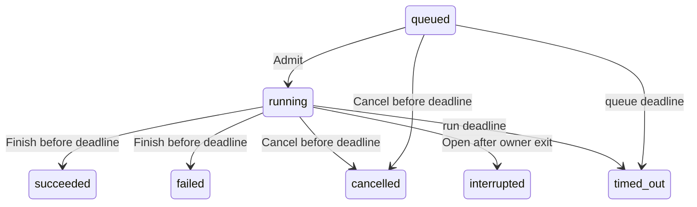

# Compute queue storage and admission contract

P10A implements the internal metadata storage/admission prerequisite of F09. See [phase evidence](../../project/phases/P10A.md) and [feature status](../../project/features/F09-gpu-job-scheduling.md). Source completion is distinct from runtime integration and deployment qualification.

## Scope and ownership

`internal/jobqueue` stores bounded classified metadata. It has no executor, public API, GPU process supervisor, prompt store or resource-isolation mechanism. Current appliance endpoints do not use it. F09 remains partial until separately reviewed workload dispatch, payload lifecycle, authenticated/auditable API/UI and target qualification are complete.

A dedicated local Linux directory must have mode `0700` and the current effective UID as owner. Each database, owner lock and sidecar must be a singly linked regular file with exact mode `0600` and that UID. Unknown files, symlinks, special files, hardlinks and unsafe modes fail closed. Ancestors must be directories owned by root/current UID, with no group/world write except root-owned sticky directories such as `/tmp`. Root/current-owner pathname mutation and filesystem compromise are outside this protection model. Do not place state on Windows-mounted, network or shared filesystems; their lock/durability behavior is not qualified.

An exclusive lifetime `flock` on `owner.lock` permits one owner. It is held until SQLite closes. One connection and a mutex serialize operations. The caller supplies a private state directory; no default path, service or deployment is introduced.

## Persistent data and bounds

Schema version `1` is a strict SQLite table with fixed columns: server-random 128-bit job ID, FIFO sequence, kind (`chat` or `model.pull`), 128-bit correlation reference, independent noncredential session audit reference, positive bounded memory estimate, queue/run timeouts, timestamps/deadlines and status. IDs are 32 lowercase hex characters. There are no prompts, credentials, model names/responses, arbitrary paths or freeform errors. References still reveal activity and remain private.

Queue timeout is positive and at most 24 hours; run timeout is positive and at most 1 hour. Timestamps preserve nanoseconds in UTC, within 1970–2200; Unix epoch zero is reserved for unset fields and rejected as an operation time. Caller time is trusted local input, not a remote timestamp.

Limits are 1,024 queued rows and 10,000 total retained rows. Terminal rows are retained; there is no automatic pruning, deletion or migration. The database is capped at 16 MiB / 4,096 pages, WAL at 17 MiB and shared-memory file at 64 KiB. The owner lock is empty. SQLite uses WAL, `synchronous=FULL`, no cache spill, and a truncate checkpoint after each successful transaction. One owner/connection and bounded transactions prevent readers pinning the WAL under the supported contract. Checks reject existing over-limit files. No external SQLite connection is supported while the owner is active.

Logical row limits leave database headroom for terminal updates; tests exercise a full retained store. This does not reserve filesystem blocks or guarantee writes on a full/failing device. Errors can occur after commit and must be reconciled.

## Admission and state transitions

`Open`, `Close`, `Enqueue`, `Get`, `List`, `Admit`, `Finish`, `Cancel` and `Expire` are the internal API. `List` requires a positive limit up to 10,000 and returns FIFO history. The store is not an authentication boundary; a future service must authorize callers and supply trusted references.

Admission considers only the oldest nonexpired queued row. An oversized head blocks smaller later jobs. At most one row may be `running`. Snapshot total/free MiB must be sane, positive total, free<=total, nonfuture and within the policy's maximum age. Missing/stale/invalid capacity yields no admission. Requested memory plus configured headroom must fit both the budget and observed free memory. Estimates and telemetry do not guarantee actual GPU use or external Ollama behavior.

The internal `running` state means a metadata reservation granted by `Admit`, not an observation that a GPU process started. All states below are metadata:

Terminal states cannot change. At the exact deadline, expiry wins: a late Finish/Cancel returns the persisted `timed_out` status. `Admit` expires elapsed records before considering capacity. Explicit `Expire` is also available; no background timer is started by this package.

Queued rows survive restart as metadata, not an executable backlog: prompts/payloads are absent. Reopening marks in-flight rows interrupted without replay, using at least the recorded start time if the clock moved backwards. Cancellation, expiry and recovery release metadata reservations only. A future dispatcher must retain physical capacity until process/device quiescence or fencing is confirmed; it must not assume an orphan stopped because this store changed status.

## Failures, backup and recovery

Existing stores require the exact schema, WAL mode, integrity validation and valid bounded rows before recovery. Existing empty/truncated databases, a missing database with retained ownership evidence, and orphan sidecars fail closed. No attempt resets history. Full deletion/replacement by the owner/root cannot be detected without independent evidence; this is not an audit hash chain.

SQLite/I/O, commit or checkpoint failures poison the owner until Close/reopen and reconciliation. No mutation returns a normal job/admission/count on these failures, even if SQLite already committed. Do not blindly retry enqueue: reopen and inspect retained metadata/correlation references first. Validation/capacity denials do not fabricate a storage success. Future APIs must classify errors rather than expose raw SQLite/filesystem errors or paths.

For backup, stop new mutations, quiesce the owner, close/checkpoint successfully and preserve the complete private state set consistently. Copying only the database while WAL is active can omit committed changes. Retain evidence on corruption or ambiguous errors; do not delete files to make Open succeed. Restore/retention/schema changes require a separately reviewed recovery plan; no repair/rotation/backup CLI or production migration is included.

## Dependency and qualification boundary

Pinned dependencies: `github.com/ncruces/go-sqlite3 v0.28.0` (MIT, embedded WebAssembly SQLite 3.50.4), wazero `v1.9.0` (Apache-2.0), julianday `v1.0.0` (MIT), and `golang.org/x/sys v0.35.0` (BSD-3-Clause). This driver supports Go 1.23; later driver releases require a newer toolchain. Review toolchain/driver updates before runtime integration rather than treating this pin as security certification. Preserve notices/licenses when distributing a future binary that imports it. Current appliance/Windows verifier binaries do not import this package.

The environment blocked the default module ZIP download; normal Go VCS fetching from the official GitHub repository succeeded with TLS/proxy and checksum verification retained. No network-policy or credential change was made.

Local tests cover real SQLite WAL settings, private files, FIFO/freshness/headroom, limits, state/time boundaries, process ownership, abrupt disposable child death, missing/corrupt state, real read-only write failure, and injected post-commit checkpoint failures. Exact local/CI evidence belongs to the phase ledger and issue-linked PR. No actual GPU dispatch, Windows/WSL filesystem behavior, physical power-loss durability, API/UI security, backup automation or production release/deployment is qualified by P10A.
